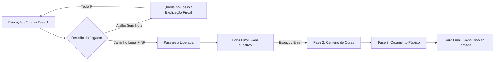

# GAME DESIGN DOCUMENT (GDD)
## O Caminho do Tributo — Educação Fiscal e Cidadania em Jogo

---

### 1. Identificação
* **Nome do Projeto:** O Caminho do Tributo
* **Projeto Extensionista:** EducaJogo Fiscal — Aprendizado de forma lúdica
* **Articulação:** NAF (Núcleo de Apoio Contábil e Fiscal) Unichristus e Receita Federal do Brasil
* **Disciplina:** Tecnologia e Desenvolvimento de Jogos Digitais (2026.2)
* **Integrantes da Equipe:** [Preencher com os nomes e matrículas dos integrantes]

---

### 2. Problema Educativo
A falta de compreensão sobre a função social dos tributos e o funcionamento do orçamento público entre os jovens. No senso comum, o imposto é frequentemente percebido apenas como uma cobrança punitiva do Estado, desconsiderando que:
1. A emissão de documentos fiscais protege o consumidor e impede a apropriação indébita de recursos pelo comércio;
2. A fiscalização social (controle cidadão) é indispensável para evitar obras fantasmas e corrupção;
3. O Estado depende da arrecadação coletiva para financiar saúde, educação, transporte e infraestrutura básica.

---

### 3. Público-Alvo
* **Público Prioritário:** Estudantes do Ensino Médio (14 a 18 anos) em ações extensionistas promovidas pelo NAF e escolas parceiras.
* **Adequações de Linguagem e Design:** 
  * Uso de mecânicas de *rage platformer* cômico (*estilo Level Devil*), altamente popular e engajante para a faixa etária.
  * Substituição de jargões contábeis pesados por termos diretos e visuais (NF, Portal GOV, Orçamento Público, Obra Paralisada).
  * Sessões curtas com reinício instantâneo (tecla `R`), incentivando tentativa, erro e aprendizado sem frustração punitiva prolongada.

---

### 4. Objetivo de Aprendizagem
Espera-se que, ao término da experiência, o jogador:
1. Associe a exigência da Nota Fiscal ao financiamento visível da cidade (passarelas e infraestrutura pública);
2. Reconheça o Portal da Transparência como instrumento democrático de combate a desvios e obras inacabadas;
3. Compreenda que a sonegação individual gera um rombo orçamentário coletivo, inviabilizando serviços essenciais.

---

### 5. Conceito do Jogo e Diferencial
* **Conceito:** Jogo de plataforma e puzzle onde o próprio cenário reage às escolhas fiscais do jogador. As "trollagens" e armadilhas do jogo não são aleatórias, mas metáforas diretas das consequências da sonegação e da corrupção.
* **Diferencial Competitivo:** Rompe com o formato tradicional de "quiz" ou texto passivo. A regra do jogo é a regra fiscal: se não houver arrecadação ou fiscalização, o chão literalmente desaparece sob os pés do personagem.

---

### 6. Gênero e Plataforma
* **Gênero:** Plataforma 2D / Puzzle de Consequência (*Rage Platformer Educativo*).
* **Plataforma de Execução:** PC (Windows / Linux / macOS) com execução local via Python / Pygame, viabilizando uso em laboratórios de informática escolares sem necessidade de placas de vídeo dedicadas ou internet.

---

### 7. Tecnologia e Justificativa Técnica
* **Tecnologia:** Python 3.10+ e Pygame-CE (Community Edition).
* **Justificativa:**
  * **Leveza e Portabilidade:** Roda em computadores básicos de escolas públicas sem engasgos (60 FPS estáveis).
  * **Independência de Rede:** Não exige login, servidores online ou instalação de softwares proprietários pesados.
  * **Domínio de Arquitetura:** Implementação orientada a objetos com separação clara de responsabilidades (`Player`, `BaseLevel`, `Level1`, `Level2`, `Level3`, `settings.py`).

---

### 8. Core Gameplay (Loop Principal)
1. **Spawn:** Jogador surge no início do cenário e observa o objetivo (Porta Verde de Cidadania).
2. **Dilema / Obstáculo:** Defronta-se com uma tentação (atalho sem nota, ponte aparentemente sólida ou abismo orçamentário).
3. **Ação Fiscal:** Coleta a NF, audita o canteiro via Portal GOV ou arrecada os tributos para a Urna.
4. **Transformação do Mundo:** O cenário altera seu estado físico (pontes surgem, plataformas móveis ativam, obras fantasmas são identificadas).
5. **Conclusão e Reflexão:** Alcança a meta e acessa o Card Educativo consolidando o aprendizado da fase.

---

### 9. Mecânicas Principais
* **Controles:** Teclas `A`/`D` ou Setas para movimento lateral; `W`, `Espaço` ou Seta Cima para pular; `R` para reinício imediato.
* **Física Orgânica (Game Feel):**
  * *Coyote Time:* Tolerância de 6 frames ao sair de beiradas.
  * *Jump Buffer:* Memorização do comando de pulo 6 frames antes de tocar o solo.
  * *Squash & Stretch:* Deformação elástica ao pular e aterrissar.
  * *Screen Shake:* Tremor de tela ao acionar armadilhas de sonegação ou falha.
* **Mecânicas Educativas Específicas:**
  * **Fase 1 (O Dilema da NF):** Atalho com placa *"SEM NOTA: -20%"* que desaba em espinhos. Coleta da NF no balcão legal reconstrói a passarela pública.
  * **Fase 2 (Obra Fantasma):** Plataformas sem colisão sólida (desvio de verba). Ativação do totem **GOV** pinta as falsas de vermelho e aciona a plataforma mecânica móvel.
  * **Fase 3 (Orçamento Público):** Coleta de 5 tributos e depósito na Urna Orçamentária. Tentativa de cruzar sem orçamento causa retração imediata da infraestrutura.

---

### 10. Objetivos e Condições
* **Condição de Vitória:** Atravessar o cenário e colidir com a porta verde de cidadania, desbloqueando o card explicativo e a próxima fase.
* **Condição de Derrota:** Colidir com espinhos pontiagudos ou cair no abismo inferior fora da tela.
* **Recuperação:** Reinício instantâneo na mesma fase mantendo o ritmo ágil de jogo.

---

### 11. Feedback ao Jogador
* **HUD Superior Dinâmico:** Exibe o status da fase em tempo real (Ex: *"NF: PENDENTE"* em vermelho para *"NF: EMITIDA"* em verde).
* **Placas no Cenário:** Mensagens visuais no meio da ação contextualizando armadilhas e serviços.
* **Feedback de Morte:** O bloco se fragmenta em estilhaços com física cômica, acompanhado de uma frase que explica a causa fiscal daquela falha.

---

### 12. Fluxo de Telas

---

### 13. Identidade Visual e Sonora
* **Estilo Visual:** Minimalista com alto contraste e geometria limpa (estilo *Level Devil*).
* **Paleta Semiótica de Cores:**
  * *Marrom Café (Wall):* Chão e estruturas comuns.
  * *Vermelho Alerta (Spike / Fake):* Risco, espinhos e obras fantasmas reveladas.
  * *Azul Tributo (NF / Urna):* Formalidade econômica e arrecadação social.
  * *Roxo Governamental (GOV):* Portal da Transparência e fiscalização cidadã.
  * *Verde Esperança (Goal / Real Wall):* Obras públicas entregues, vitória e retorno social.

---

### 14. Relação Gameplay × Educação Fiscal
| Elemento de Jogo | Conceito Fiscal Correspondente | Aprendizado Prático |
| :--- | :--- | :--- |
| **Ponte do Desconto que rui** | Sonegação no consumo informal | Quem compra sem nota perde garantia e deteriora a infraestrutura da cidade. |
| **Plataformas intangíveis** | Obras públicas fantasmas / desvios | A ausência de fiscalização permite que obras pagas nunca existam na prática. |
| **Totem GOV** | Portal da Transparência e Lei de Acesso | O controle social ativo transforma gastos suspeitos em obras concluídas. |
| **Coleta de moedas para a Urna** | Arrecadação tributária equânime | Serviços públicos e pontes não surgem do nada; dependem da contribuição coletiva. |
| **Retração das pontes no salto** | Rombo / Déficit orçamentário | Se a população não contribui, as contas públicas entram em colapso. |

---

### 15. Referências Pesquisadas
* **Receita Federal do Brasil:** Programa Nacional de Educação Fiscal (PNEF) e materiais pedagógicos de Cidadania Fiscal na Educação Básica.
* **NAF (Núcleo de Apoio Contábil e Fiscal):** Diretrizes de Extensão Universitária e Cidadania Fiscal.
* **Metodologias Ativas:** Jogos conceituais *"A Ilha"* e *"Pago ou Não?"* (Receita Federal).
* **Game Design:** Análise de mecânicas de *game feel* e humor de *Level Devil* (desenvolvido por Unept).

---

### 16. Escopo Entregue na NP2
* Protótipo 100% jogável com 3 fases temáticas completas.
* Sistema de física customizado com *Coyote Time*, *Jump Buffer*, partículas de morte e *Squash & Stretch*.
* Sistema de HUD dinâmico e Cards de consolidação pedagógica ao final de cada fase.
* Código modularizado em 4 scripts (`main.py`, `settings.py`, `player.py`, `level.py`).

---

### 17. Divisão de Atividades da Equipe
* **Game Designer & Pesquisa Pedagógica:** Esdras Sales Nobre — Levantamento de diretrizes da Receita Federal/NAF e elaboração do GDD.
* **Programação de Gameplay & Física:** Esdras Sales Nobre — Implementação do loop principal, movimentação e colisões no Pygame.
* **Level Design & Balanceamento:** Esdras Sales Nobre — Mapeamento dos blocos, armadilhas, moedas e testes de jogabilidade.

---

### 18. Uso de Ferramentas de IA Generativa
* **Ferramentas Utilizadas:** Google Antigravity / LLM para apoio em prototipação de ideias e cálculo de curvas de física.

---

## 6.1 Ficha de Aplicação Extensionista (NAF / Escolas)

* **Público Esperado e Faixa Etária:** Alunos do 1º ao 3º ano do Ensino Médio (14 a 18 anos).
* **Objetivo Educativo:** Desmistificar a tributação, demonstrando aos jovens que exigir nota fiscal e acompanhar os gastos públicos é um exercício prático de cidadania que impacta a sua própria cidade.
* **Duração da Experiência:** 15 a 20 minutos (jogabilidade individual de ~5 minutos + 10 a 15 minutos de debate guiado).
* **Equipamentos Necessários:** Computadores comuns (Windows, Linux ou macOS), teclado e monitor. Não exige GPU dedicada.
* **Conexão com a Internet:** Não necessária (jogo roda 100% offline).
* **Instalações e Dependências:** Python instalado e biblioteca `pygame-ce` via pip (`pip install pygame-ce`).
* **Instruções para o Mediador (Monitor do NAF):**
  1. Apresentar brevemente o jogo como um desafio de plataforma estilo "troll game";
  2. Pedir para que o aluno jogue livremente a Fase 1 sem dar dicas prévias;
  3. Observar a reação do aluno ao cair na armadilha do "Desconto sem Nota";
  4. Ao término das 3 fases, abrir o debate com a turma utilizando as questões norteadoras.
* **Questões para Discussão Pós-Jogo:**
  1. *"Por que o atalho do desconto sem nota parecia tão atraente no começo da Fase 1? Isso acontece na vida real?"*
  2. *"Como o Portal da Transparência da nossa cidade pode ser acessado no celular de vocês para fiscalizar obras do bairro?"*
  3. *"Na Fase 3, o que aconteceu quando tentamos avançar sem colocar os recursos na Urna? O que isso representa nos hospitais públicos?"*
* **Limitações Conhecidas e Cuidados:**
  * O jogo possui dificuldade de precisão nos saltos; o mediador deve incentivar o uso da tecla `R` para que o aluno não desista diante de erros comuns de plataforma.
